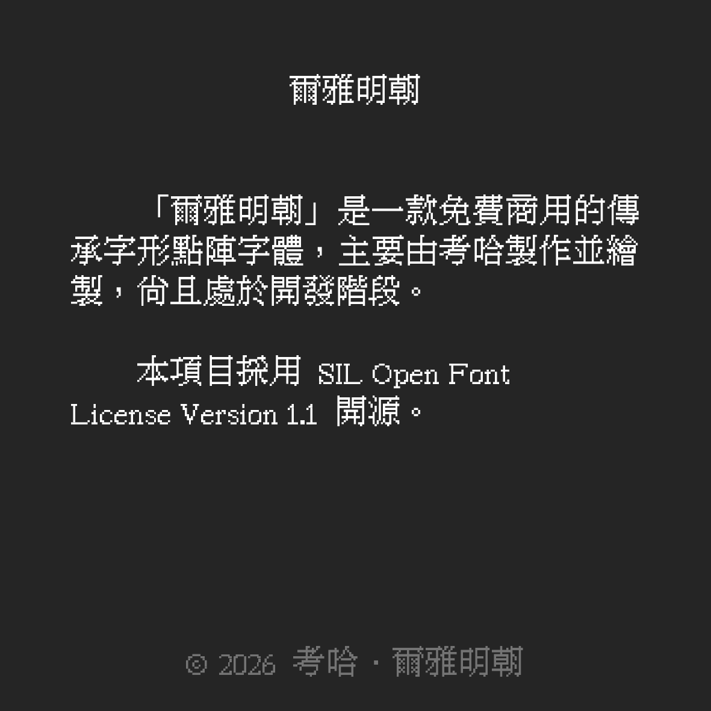
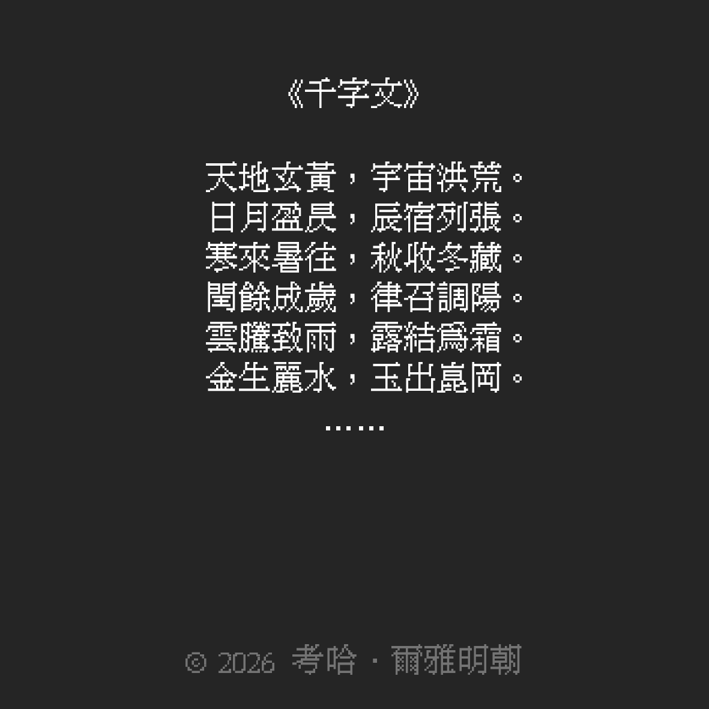
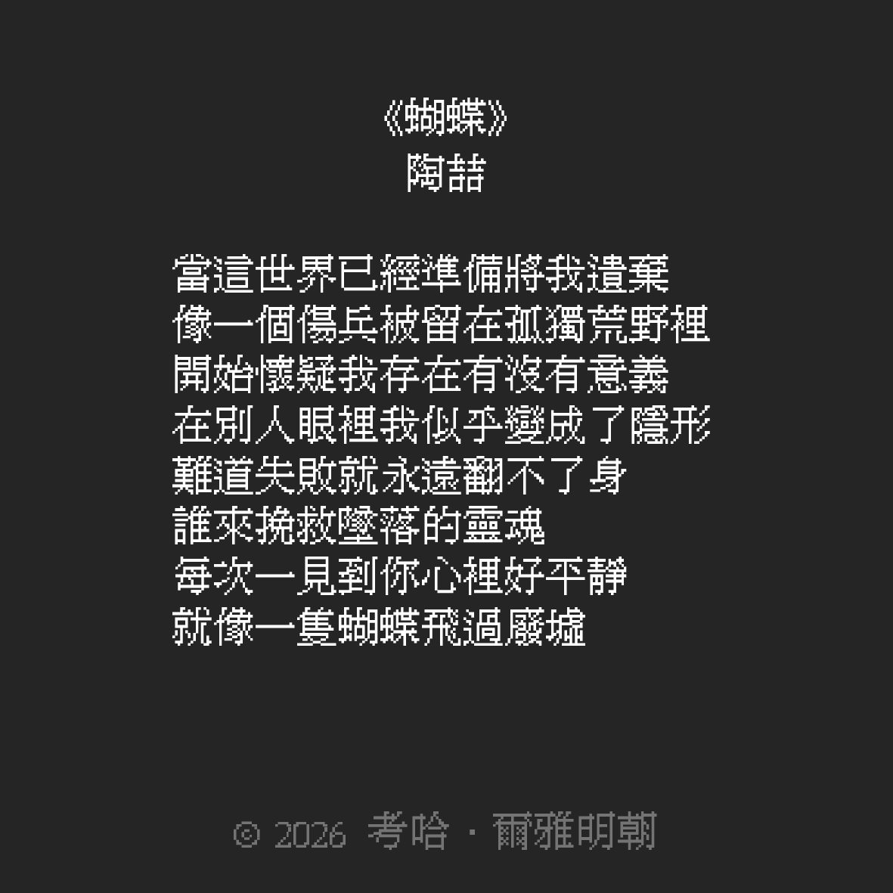
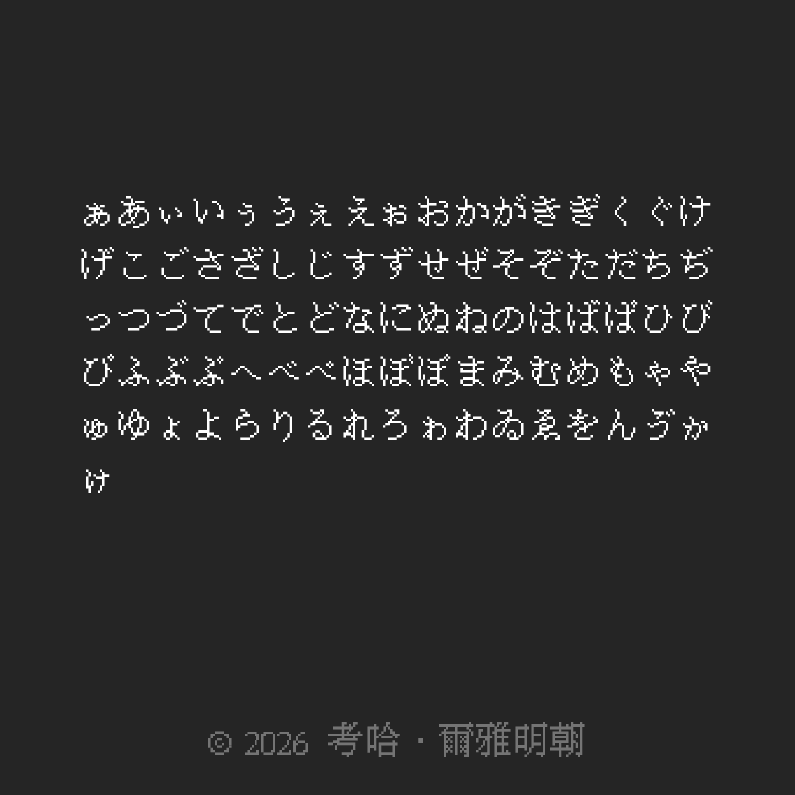
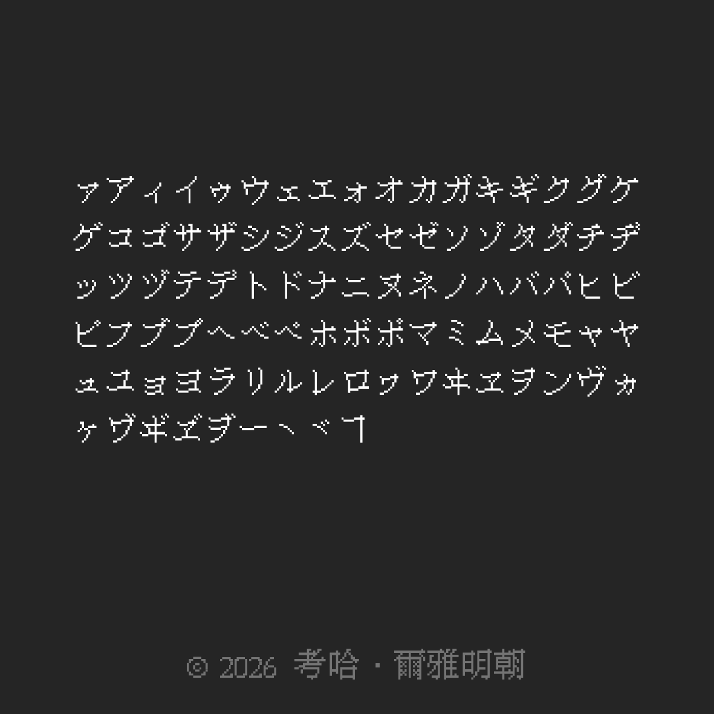
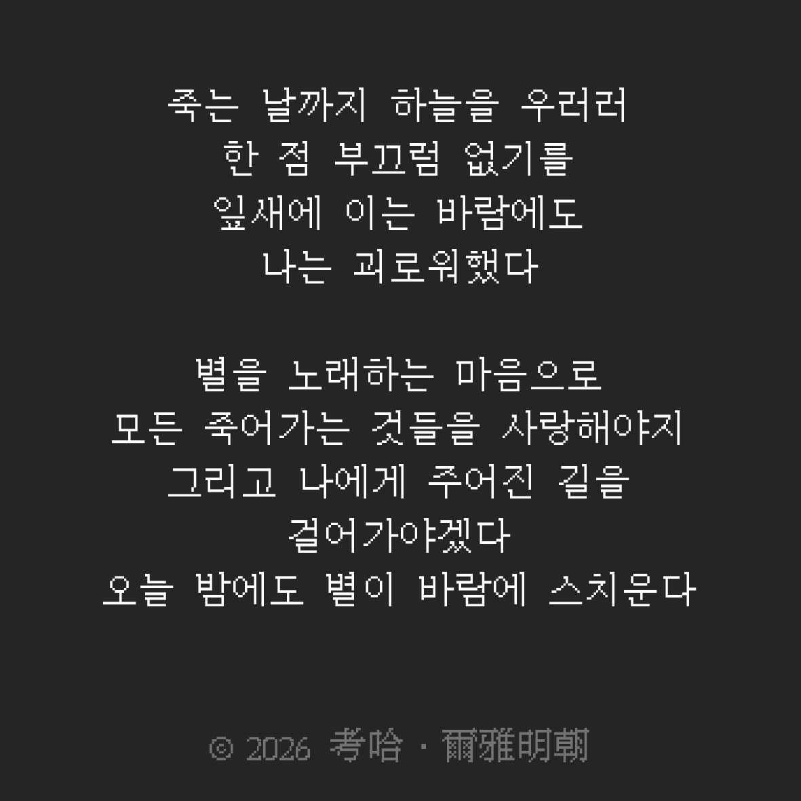
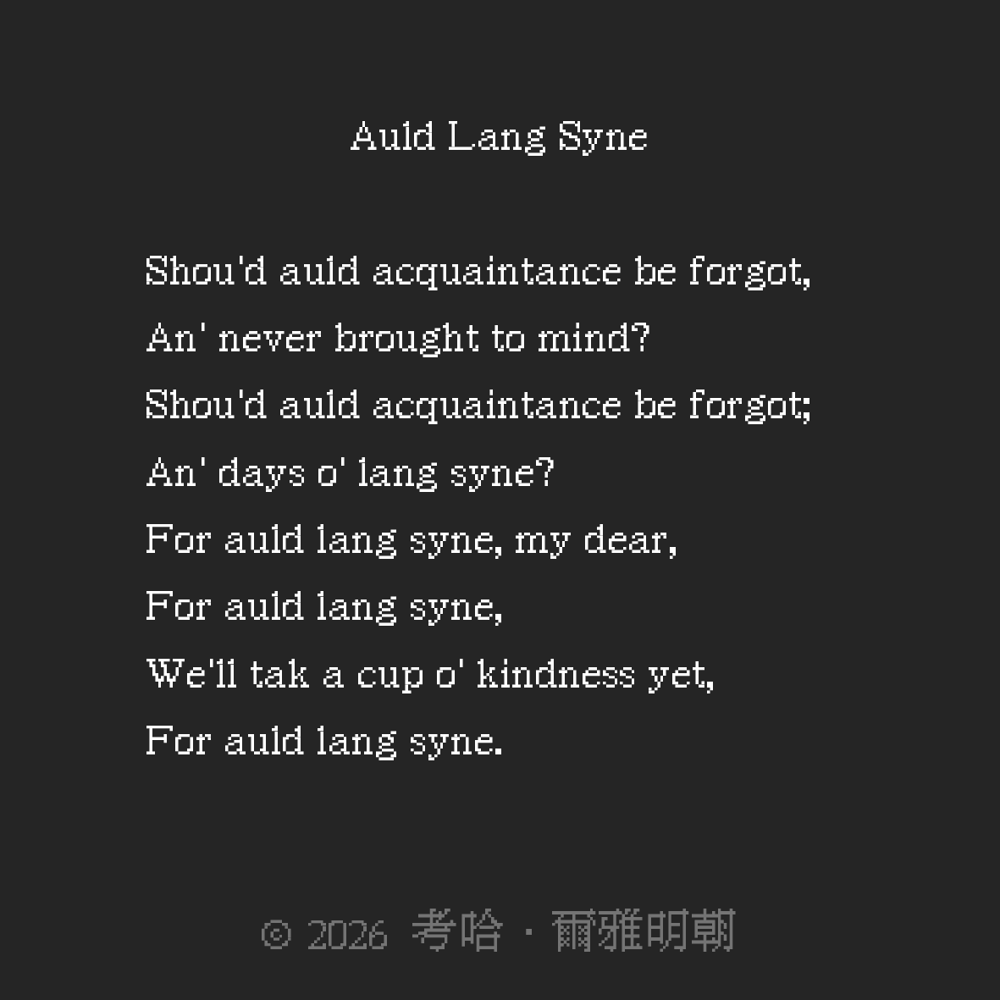
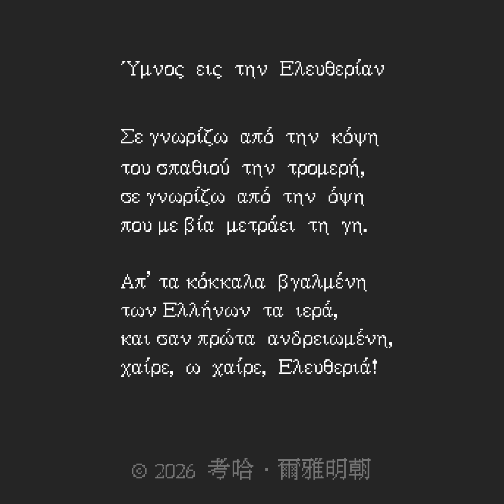
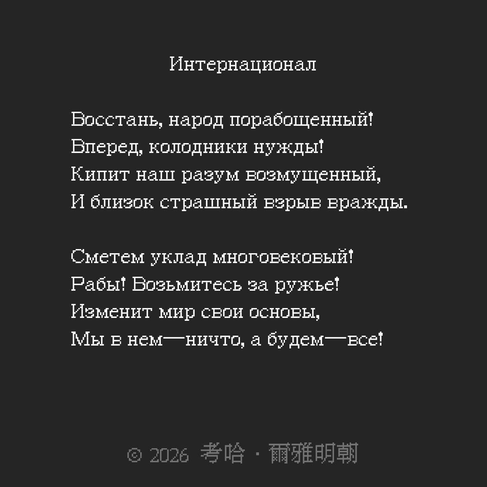
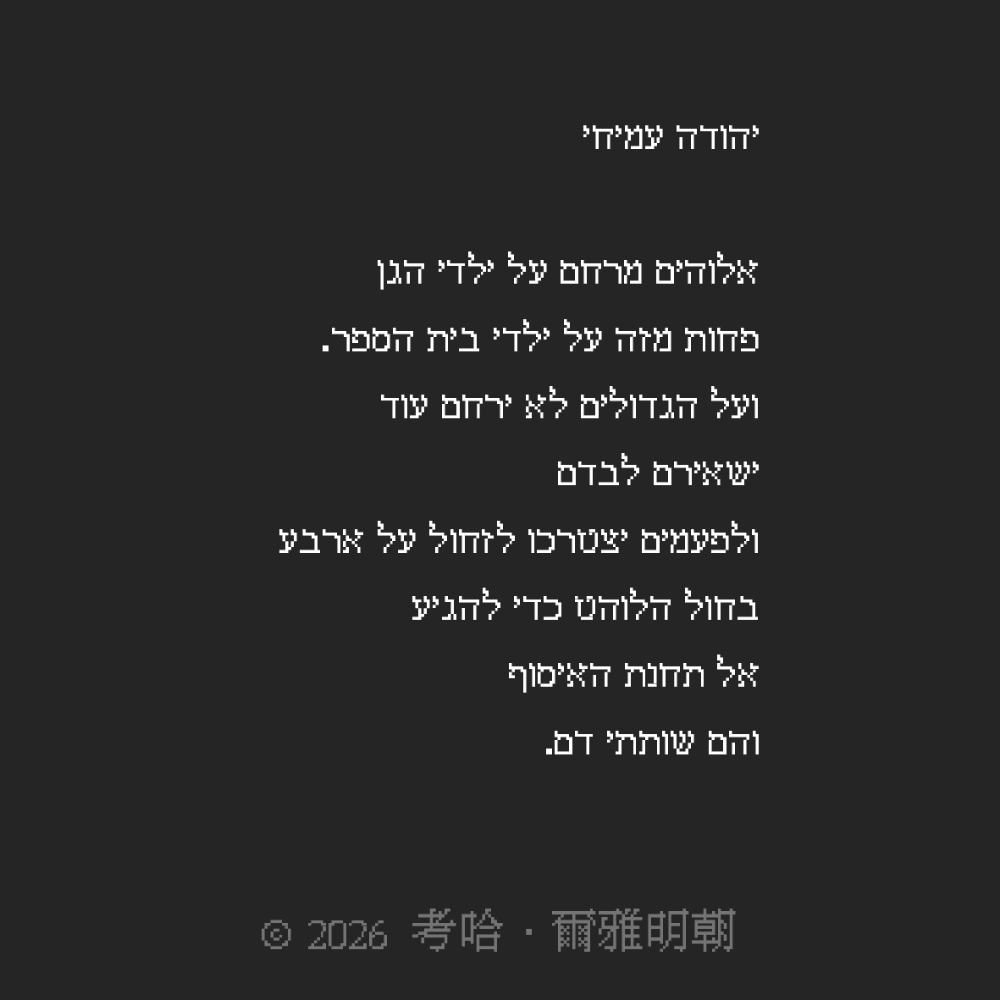

[繁體中文](./README.MD) | **English**

# _Erya Mincho_

## Description
**_Erya Mincho_** is a 16×16 bitmap Mincho font, mainly designed and drawn by Koolhaas. It is currently under development.

## Concept
Striving to create an **Inherited Glyphs** bitmap font that is **free to use**, **faithful** to glyph forms, and **visually refined**!

## Coverage

### Chinese

    
    
    

#### Current Progress

|Block|Progress|
|---|---|
|CJK Unified Ideographs||
|CJK Unified Ideographs Extension A||
|Total||

Planning to support the CJK Unified Ideographs Basic Block and Extension A.

---

### Hiragana & Katakana

    
    

### Hangul Syllables
> The Hangul Glyphs are derived from **_Batang_**, a serif typeface designed by **HanYang I&C Co.**
 
The source is the version released under the **SIL Open Font License 1.1** from the [official Google Fonts GitHub repository](https://github.com/googlefonts/batang).

### Western Scripts

    
    
    
    

## License
This project is licensed under the **SIL Open Font License 1.1**.

Before August 8, 2026, it was licensed under CC BY-ND 4.0 (versions before the `old-license` tag). The license was changed to facilitate contributions and modifications on August 8, 2026.

Older versions remain under the original license.

## Sponsor
